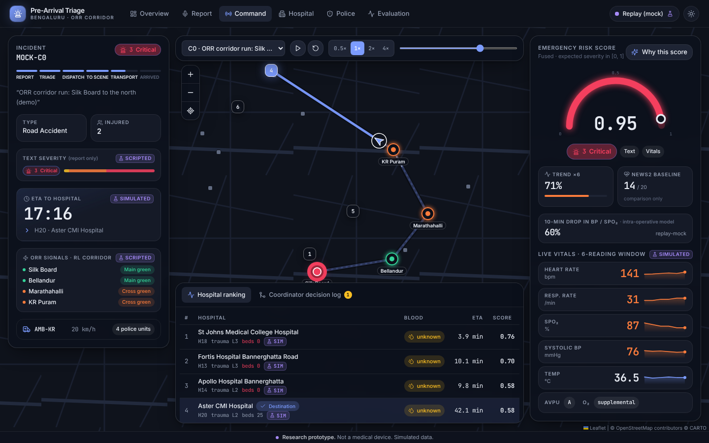

# Pre-Arrival Multimodal AI Triage & Emergency Coordination — Bengaluru

Final-year B.E. (AI & ML) project, CMR Institute of Technology, Bengaluru.

> **Research prototype, not a medical device.** Not clinically validated. Must not be used for
> real patient care or real emergency dispatch.

A bystander reports an emergency by voice or text in **Kannada, Hindi or English** → the system asks
guided follow-up questions and gives first-aid steps grounded in IFRC guidelines → an ambulance vitals
stream is scored for severity and short-term deterioration → reinforcement learning controls traffic
signals on the Outer Ring Road (simulated in SUMO) → a hospital agent picks the best receiving hospital
→ a rule-based coordinator issues the dispatch and alerts traffic police.

The contribution is **context and integration** (pre-arrival, multilingual, low-resource, Bengaluru) of
established methods, evaluated honestly against clinical and rule-based baselines. It is not a new
architecture.



## Components

| # | Component | Methods |
|---|---|---|
| 1 | **Reporting** | Whisper ASR (per-language fine-tunes for kn/hi), bounded 6-question dialogue state machine, extractive RAG over the IFRC 2020 first-aid corpus (FAISS + bge-small), text severity classifier |
| 2 | **Vitals** | NEWS2, tabular baselines (LR/RF/GB), two-head BiGRU (MIMIC-IV Demo), 10-min deterioration model (VitalDB, calibrated HGB), vitals + text fusion, SHAP / Integrated Gradients explanations |
| 3 | **Traffic** | SUMO model of the ORR corridor from OpenStreetMap, calibrated to TomTom travel times; DQN signal control (Stable-Baselines3) vs fixed-time and always-green; police alerting |
| 4 | **Hospital + integration** | Capability-aware hospital ranking (trauma level, beds, specialty, blood stock), rule-based coordinator, FastAPI + WebSocket backend, React dashboard |

## Key results

All numbers are logged runs (`experiments/log.csv`, `reports/`). Full tables and caveats:
[`docs/RESULTS_SUMMARY.md`](docs/RESULTS_SUMMARY.md).

| Area | Result |
|---|---|
| ASR (held-out real recordings) | WER en 8.3 %, hi 24.3 %, kn 58.0 % with the deployed per-language models |
| First-aid RAG (v3, 33 IFRC topics, 76 test queries) | hit@4 0.95, in-scope answer rate 0.98, out-of-scope refusal 0.60; every sentence is retrieved corpus text |
| Vitals severity (MIMIC-IV Demo, nested grouped CV) | BiGRU macro-F1 0.386 vs NEWS2 0.278 |
| 10-min deterioration (VitalDB, 203k windows) | HGB PR-AUC 0.512 / AUROC 0.833 vs NEWS2 0.242 / 0.660 |
| Traffic RL, schematic corridor | DQN cuts ambulance transit time by 14–15 % vs fixed-time signals |
| Traffic RL, real OSM corridor | Best seed −39 % / −34 % vs fixed-time at medium / peak traffic; other seeds unstable (under-trained) |
| Hospital selection (10 scenarios) | Appropriate hospital 9/10 vs 5/10 for nearest-hospital baseline, +1.6 min |

Limits: ICU and intra-operative vitals, not pre-hospital; fusion uses synthetic text; hospital beds and
blood stock are simulated.

## Repository layout

```
backend/        FastAPI app (main.py), coordinator, schemas
  agents/       hospital + police agents
  asr/          Whisper transcription, WER / noise / latency evaluation
  dialogue/     bounded triage state machine + multilingual lexicon
  rag/          first-aid retrieval pipeline + evaluation
  ml/           NEWS2, baselines, BiGRU, VitalDB model, fusion, text severity, explainability
  rl/           SUMO environments, DQN training, baselines
  data/         MIMIC / VitalDB windowing and labels
web/            React + Vite + TypeScript dashboard (served at /app/)
frontend/       plain HTML fallback pages (served at /ui/)
data/           corpus, hospitals, ambulance bases, ASR test clips, traffic data, processed datasets
models/         trained models (BiGRU, fusion, VitalDB HGB, text classifier, DQN, RAG index)
sumo/           SUMO networks, demand files, OSM corridor
scripts/        data collection, corpus extraction, demo builders
reports/        evaluation CSVs and figures
experiments/    log.csv — one row per reported run
tests/          pytest suite
docs/           design docs, decisions, model card, results, demo runbook
```

## Setup

Requirements: Python 3.12, Node.js 18+, [SUMO](https://eclipse.dev/sumo/) 1.20+ (for the traffic part).
An NVIDIA GPU is recommended for live voice input.

```bash
git clone https://github.com/madhanmatthew/prearrival-triage-blr.git
cd prearrival-triage-blr
python -m venv .venv
.venv\Scripts\activate                  # Linux/macOS: source .venv/bin/activate
pip install -r requirements.txt
pip install -r requirements-gpu.txt     # optional, CUDA
copy .env.example .env                  # Linux/macOS: cp; API keys are optional
```

Run the tests:

```bash
python -m pytest -q
```

## Running the demo

1. Build the dashboard once:
   ```bash
   cd web && npm install && npm run build && cd ..
   ```
2. Start the API (Windows: double-click `_start_server.bat`):
   ```bash
   python -m uvicorn backend.main:app --host 127.0.0.1 --port 8000
   ```
3. Open <http://127.0.0.1:8000/>. The home page shows the backend status and links to the reporter,
   dispatcher, police and hospital views.
4. Traffic simulation (needs SUMO):
   ```bash
   python -m scripts.demo_sumo --policy fixed_time --slot peak
   python -m scripts.demo_sumo --policy dqn --seed 2 --slot peak
   ```

Step-by-step live demo script: [`docs/DEMO_RUNBOOK.md`](docs/DEMO_RUNBOOK.md).

Whisper models are downloaded on first use. Without `ORS_API_KEY` routing falls back to straight-line ETAs.

## Reproducing results

Every training and evaluation step is one `make` target (Windows: run from Git Bash), e.g.

```bash
make train-baselines   # tabular baselines, nested grouped CV
make train-seq         # BiGRU
make eval-rag          # first-aid retrieval evaluation
make rl-train SEED=1   # DQN on the corridor
make help              # list all targets
```

The VitalDB raw data is not stored in the repo; download it with `python scripts/download_vitaldb.py`
(the processed windows are in `data/processed/`).

## Documentation

- [`docs/00_MASTER_OVERVIEW.md`](docs/00_MASTER_OVERVIEW.md) — project overview
- [`docs/15_DECISIONS_FINAL.md`](docs/15_DECISIONS_FINAL.md) — final design decisions
- [`docs/07_interfaces_and_schemas.md`](docs/07_interfaces_and_schemas.md) — API and message contracts
- [`docs/MODEL_CARD_VITALS.md`](docs/MODEL_CARD_VITALS.md) — vitals model card
- [`docs/10_risks_ethics_scope.md`](docs/10_risks_ethics_scope.md) — risks, ethics and scope
- Component docs `01`–`05`, data and labels `08`, setup `09`, traffic calibration `19`

## Data and licences

- MIMIC-IV Clinical Database Demo v2.2 and MIMIC-IV-ED Demo v2.2 (PhysioNet, open access, ODbL).
  Credentialed MIMIC-IV is never committed.
- VitalDB open dataset (downloaded by script).
- IFRC International First Aid, Resuscitation and Education Guidelines 2020.
- OpenStreetMap (ODbL), TomTom free-tier traffic APIs, published Bengaluru Traffic Police counts.

Sources and terms per file: [`PROVENANCE.md`](PROVENANCE.md), [`data/PROVENANCE.md`](data/PROVENANCE.md).

## Team

Madhan, Sankalp, Chetan, Ragavendra — CMR Institute of Technology, Bengaluru.
